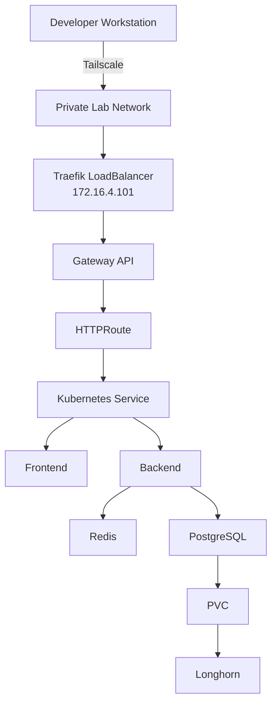
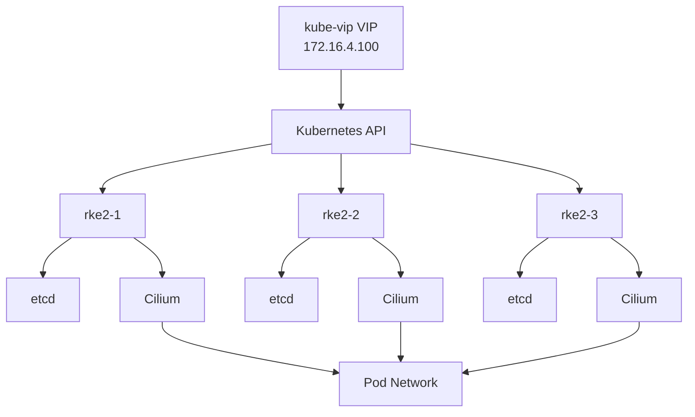
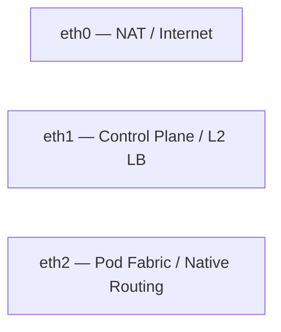
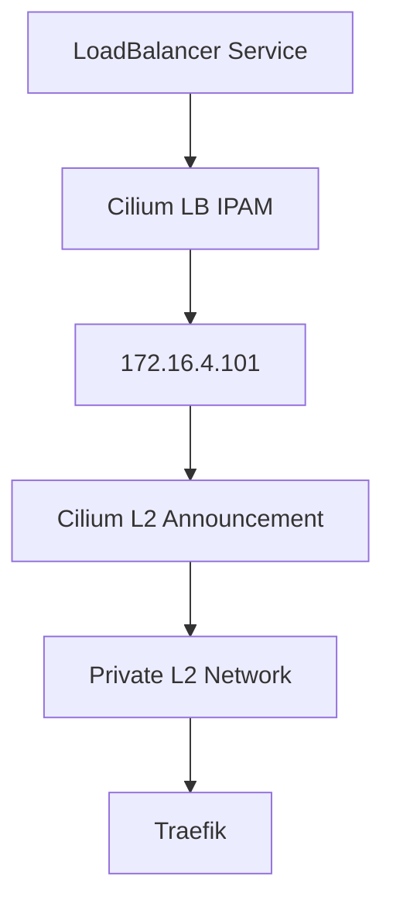
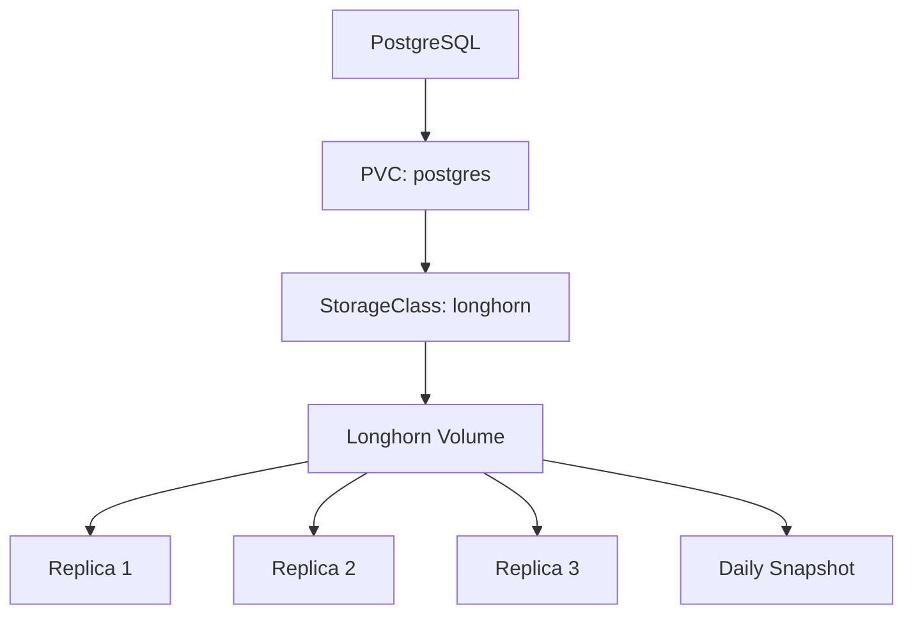

# Private Kubernetes Platform — Hosting Mosalam Intern Lab

A small, production-style private Kubernetes platform built and operated in the Hosting Mosalam Intern Lab. This document describes what is actually implemented, how it works, why specific design decisions were made, and what is still planned. It is written as real engineering documentation for the platform, not as a generic Kubernetes tutorial.

The platform currently spans:

* **Infrastructure** — RKE2 Kubernetes, three-node control plane with kube-vip
* **Networking** — Cilium (eBPF, native routing, kube-proxy replacement)
* **Ingress / Gateway** — Gateway API with Traefik
* **Storage** — Longhorn persistent storage with automated snapshots
* **Delivery** — Argo CD GitOps

Planned future layers — additional observability, progressive delivery, and additional security hardening — are documented separately below as explicitly not yet implemented.

---

## Table of Contents

1. [Lab Infrastructure](#1-lab-infrastructure)
2. [Network Architecture](#2-network-architecture)
3. [RKE2 High-Availability Cluster](#3-rke2-high-availability-cluster)
4. [Bootstrap Consideration: kube-vip + Cilium](#4-bootstrap-consideration-kube-vip--cilium)
5. [Cilium Networking](#5-cilium-networking)
6. [Gateway API and Traefik](#6-gateway-api-and-traefik)
7. [Private Access Model](#7-private-access-model)
8. [Application Platform](#8-application-platform)
9. [Application Configuration and Secrets](#9-application-configuration-and-secrets)
10. [Persistent Storage with Longhorn](#10-persistent-storage-with-longhorn)
11. [GitOps with Argo CD](#11-gitops-with-argo-cd)
12. [Current GitOps Repository Implementation](#12-current-gitops-repository-implementation)
13. [Observed Cluster State](#13-observed-cluster-state)
14. [Failure Testing — Planned](#14-failure-testing--planned)
15. [GitOps CI Validation — Planned](#15-gitops-ci-validation--planned)
16. [Observability — Planned](#16-observability--planned)
17. [Progressive Delivery — Planned](#17-progressive-delivery--planned)
18. [Security](#18-security)
19. [Architecture Diagrams](#19-architecture-diagrams)
20. [Design Decisions](#20-design-decisions)
21. [Implemented vs. Planned](#21-implemented-vs-planned)

---

## 1. Lab Infrastructure

The lab runs on a single Proxmox host. Three virtual machines were created for the Kubernetes cluster: `rke2-1`, `rke2-2`, `rke2-3`.

**Important limitation:** all three VMs run on the same physical Proxmox host. This means:

* Kubernetes control-plane HA is implemented at the **VM/node level**, not the physical-host level.
* etcd quorum is provided across the three Kubernetes nodes.
* Failure of a single Kubernetes VM can be tolerated by the control plane.
* Failure of the underlying Proxmox host would affect **all three** nodes simultaneously.

This is a simulated failure domain: the architecture mirrors what three independent physical servers would look like, but the VMs do not currently have true physical failure-domain isolation from each other.

---

## 2. Network Architecture

Each VM has three network interfaces, each with a distinct role:

| Interface | Role                  | Notes                                                                                       |
| --------- | --------------------- | ------------------------------------------------------------------------------------------- |
| `eth0`    | NAT network           | Internet access, package/image downloads, default route                                     |
| `eth1`    | Control plane network | Internal control-plane communication, Kubernetes API traffic, L2 LoadBalancer announcements |
| `eth2`    | Pod fabric network    | Native pod-to-pod routing path between nodes                                                |

Internal networks use **MTU 1400**. NAT addresses are intentionally not used for internal Kubernetes node-to-node communication — cluster traffic stays on the internal interfaces.

### Example network inventory

| Node   | NAT (`eth0`)     | Control Plane (`eth1`) | Pod Fabric (`eth2`) |
| ------ | ---------------- | ---------------------- | ------------------- |
| rke2-1 | 192.168.32.4/20  | 172.16.0.4/18          | 172.17.0.3/18       |
| rke2-2 | 192.168.32.35/20 | 172.16.0.34/18         | 172.17.0.34/18      |
| rke2-3 | —                | 172.16.0.35/18         | 172.17.0.35/18      |

The `rke2-3` NAT address was not retained in the final inventory. The internal subnet architecture is:

* Control plane: `172.16.0.0/18`
* Pod fabric: `172.17.0.0/18`

### Netplan configuration (example: rke2-1)

```yaml
network:
  version: 2

  ethernets:
    eth0:
      addresses: [192.168.32.4/20]
      routes:
        - to: default
          via: 192.168.32.1

    eth1:
      addresses: [172.16.0.4/18]

    eth2:
      addresses: [172.17.0.3/18]
```

The other nodes follow the same interface model with their own addresses. There is no additional manual static routing configured between the internal Kubernetes networks; pod routing is handled by Cilium's native routing configuration.

---

## 3. RKE2 High-Availability Cluster

RKE2 is deployed as a three-server control-plane cluster with embedded etcd.

### First server configuration

```yaml
token: <cluster-token>

node-name: rke2-1

node-ip: 172.17.0.3

kubelet-arg:
  - node-ip=172.17.0.3

advertise-address: 172.16.0.4

tls-san:
  - 172.16.4.100
  - <control-plane-node-addresses>
  - <pod-fabric-node-addresses>

cluster-cidr: 10.42.0.0/16
service-cidr: 10.43.0.0/16
cluster-dns: 10.43.0.10
cluster-domain: cluster.local

cni: cilium
disable-kube-proxy: true
write-kubeconfig-mode: 0644

ingress-controller: traefik

disable:
  - rke2-ingress-nginx
```

Additional servers join using the shared cluster token against the API VIP:

```yaml
server: https://172.16.4.100:9345
```

Cluster tokens are never committed to this repository or exposed in documentation.

### API endpoint: kube-vip

The Kubernetes API endpoint is fronted by **kube-vip**, providing a stable virtual IP independent of any single control-plane node.

* VIP: `172.16.4.100`
* API port: `6443`
* Interface: `eth1`
* Mode: ARP, control-plane mode
* Leader election enabled
* Lease duration: `15s`
* Renew deadline: `10s`
* Retry period: `2s`

kube-vip runs as a DaemonSet on all control-plane nodes.

### Why three control-plane nodes?

* Provides etcd quorum and tolerates the loss of one node out of three.
* Allows the control plane to keep operating as long as quorum is maintained.
* Provides an HA control-plane topology at the Kubernetes node/VM level.

As noted in [Section 1](#1-lab-infrastructure), this is not physical high availability because all three VMs share one Proxmox host.

---

## 4. Bootstrap Consideration: kube-vip + Cilium

During initial cluster bootstrap, a sequencing dependency was encountered between kube-vip and Cilium:

* kube-vip was initially started before the CNI was fully available and attempted to reach the Kubernetes API through in-cluster service networking.
* Cilium was initially configured to reach the Kubernetes API through the VIP, which kube-vip had not yet made available.
* The result was a bootstrap dependency between the two components.

**Workaround used:**

1. Start Cilium pointed at the control-plane node's advertise address.
2. Allow Cilium to initialize and bring up pod networking.
3. Start kube-vip and allow the API VIP to become available.
4. Reconfigure Cilium to use the API VIP.
5. Continue normal operation using `172.16.4.100:6443`.

The final steady-state configuration uses the kube-vip VIP for Cilium's Kubernetes API connection.

---

## 5. Cilium Networking

Cilium is configured as the RKE2 CNI through an RKE2 HelmChartConfig.

```yaml
kubeProxyReplacement: true

gatewayAPI:
  enabled: false

k8sServiceHost: 172.16.4.100
k8sServicePort: 6443

routingMode: native
autoDirectNodeRoutes: true
ipv4NativeRoutingCIDR: 10.42.0.0/16

ipam:
  mode: cluster-pool
  operator:
    clusterPoolIPv4PodCIDRList:
      - 10.42.0.0/16
    clusterPoolIPv4MaskSize: 22

MTU: 1400

ipv4:
  enabled: true

ipv6:
  enabled: false

enableIPv4Masquerade: true

devices:
  - eth0
  - eth1
  - eth2

nodePort:
  directRoutingDevice: eth2

loadBalancer:
  mode: snat

l2announcements:
  enabled: true
  leaseDuration: 15s
  leaseRenewDeadline: 5s
  leaseRetryPeriod: 2s

hubble:
  enabled: true
  relay:
    enabled: true
  ui:
    enabled: true
    baseUrl: "/kube/hubble/"
```

Cilium replaces kube-proxy using eBPF, uses native routing instead of an overlay tunnel, and provides LoadBalancer IP allocation and L2 advertisement for the private lab network. RKE2 documents the combination of `disable-kube-proxy: true`, `kubeProxyReplacement: true`, and the Kubernetes API host/port settings for this deployment model.

### Native routing

With `routingMode: native`, Cilium routes pod traffic through the underlying node network rather than encapsulating the traffic in an overlay such as VXLAN.

```text
Pod A
  |
  v
Node 1 / eth2
  |
  | native routing
  v
Node 2 / eth2
  |
  v
Pod B
```

### Pod IP management

Cilium uses `cluster-pool` IPAM with:

```text
Cluster pool: 10.42.0.0/16
Per-node allocation: /22
```

This gives each node its own Pod CIDR from the shared cluster pool.

### LoadBalancer IP management

Cilium LB IPAM is used to allocate LoadBalancer IPs from a dedicated pool:

```yaml
apiVersion: cilium.io/v2
kind: CiliumLoadBalancerIPPool
metadata:
  name: main-pool
spec:
  blocks:
    - start: 172.16.4.101
      stop: 172.16.4.150
```

The pool provides the address range available to `LoadBalancer` Services. LB IPAM is responsible for **allocation**, not for advertising the assigned address on the physical network.

### L2 LoadBalancer announcements

After an IP is allocated, Cilium L2 announcements make the LoadBalancer IP reachable on the local Layer 2 network.

```yaml
apiVersion: cilium.io/v2alpha1
kind: CiliumL2AnnouncementPolicy
metadata:
  name: traefik-l2
spec:
  interfaces:
    - eth1
  externalIPs: true
  loadBalancerIPs: true
```

The policy tells Cilium to advertise LoadBalancer IPs through `eth1`. For IPv4, this is done through ARP. Only the selected active node responds to ARP for a given service IP at a time.

The overall flow is:

```text
LoadBalancer Service
        |
        v
Cilium LB IPAM
        |
        | allocates 172.16.4.101
        v
L2 Announcement
        |
        | ARP on eth1
        v
Private Network
        |
        v
Traefik
```

In this cluster, Traefik currently uses `172.16.4.101` as its LoadBalancer IP.

### Hubble

Hubble is enabled for network observability:

* Hubble agent
* Hubble Relay
* Hubble UI

The UI is exposed under:

```text
/kube/hubble/
```

---

## 6. Gateway API and Traefik

Gateway API CRDs are installed independently of Traefik. Traefik is deployed as the Gateway API controller, while the traditional Kubernetes Ingress provider is disabled.

```yaml
service:
  enabled: true
  type: LoadBalancer
  ExternalTrafficPolicy: Cluster

providers:
  kubernetesIngress:
    enabled: false
  kubernetesGateway:
    enabled: true

ports:
  traefik:
    port: 8000
  web:
    port: 80
  websecure:
    port: 443
    http:
      tls:
        enabled: true

gateway:
  enabled: true
```

The important points are:

* `kubernetesIngress.enabled: false`: disables Traefik's traditional Kubernetes Ingress provider.
* `kubernetesGateway.enabled: true`: enables the Gateway API provider.
* `gateway.enabled: true`: enables Traefik Gateway support.
* `service.type: LoadBalancer`: exposes Traefik through a Kubernetes LoadBalancer Service.
* `web` / `websecure`: provide HTTP and HTTPS entrypoints on ports `80` and `443`.

### Gateway API CRDs

```bash
kubectl apply -f https://github.com/kubernetes-sigs/gateway-api/releases/download/v1.6.1/standard-install.yaml
```

### LoadBalancer path

Cilium provides the LoadBalancer IP allocation and L2 advertisement:

```text
Traefik Service
      |
      v
Cilium LB IPAM
      |
      v
172.16.4.101
      |
      v
Cilium L2 Announcement
      |
      v
eth1 / private network
```

The Traefik Service does not hard-code its LoadBalancer IP. The IP is allocated from the configured Cilium pool.

### Application routing

The Mates application uses a Gateway and HTTPRoute in the `mates-app` namespace.

```text
                    Traefik
                       |
                 Gateway API
                       |
              mates.kube.local
                       |
              +--------+--------+
              |                 |
           /api, /ws             /
              |                 |
              v                 v
           backend          front-service
```

The application Gateway uses the Traefik GatewayClass:

```yaml
kind: Gateway
metadata:
  name: mates-gateway
  namespace: mates-app
spec:
  gatewayClassName: traefik
```

The HTTPS listener terminates TLS using the `gw-cert` Secret.

The HTTPRoute forwards:

```text
/api  -> backend:8000
/ws   -> backend:8000
/     -> front-service:80
```

The route is available through:

```text
mates.kube.local
```

### Hubble UI

```text
hubble.kube.local
        |
        v
     kube-gw
        |
        v
   hubble-ui:80
```

### Longhorn

```text
longhorn.kube.local
        |
        v
   longhorn-gw
        |
        v
longhorn-frontend:80
```

### TLS

TLS termination uses a self-signed certificate generated with OpenSSL. The lab uses private/internal access rather than public internet exposure.

---

## 7. Private Access Model

This platform is not exposed as a public internet-facing application.

Access is provided through Tailscale, which routes traffic from the developer workstation into the lab network. Internal hostnames under `*.kube.local` are resolved locally on the workstation.

```text
Developer Workstation
        |
        | Tailscale route
        v
Private Lab Network
        |
        v
Traefik LoadBalancer
172.16.4.101
        |
        v
Gateway
        |
        v
HTTPRoute
        |
        v
Kubernetes Service
        |
        v
Application Pods
```

This is a private/lab access path, not a public internet deployment.

---

## 8. Application Platform

The reference application deployed on the platform is **Mates**, running in the `mates-app` namespace.

| Component  | Kind                              | Replicas | Service              | Port |
| ---------- | --------------------------------- | -------: | -------------------- | ---: |
| Frontend   | Deployment (`front-dep`)          |        2 | `front-service`      |   80 |
| Backend    | Deployment (`backend`)            |        2 | `backend`            | 8000 |
| PostgreSQL | Deployment (`postgres-users-dep`) |        1 | `postgres-users-svc` | 5432 |
| Redis      | Deployment (`redis-dep`)          |        1 | `redis-svc`          | 6379 |

Redis is used as a non-persistent cache/messaging component.

PostgreSQL is backed by Longhorn persistent storage.

PostgreSQL currently runs as a plain Deployment with a single replica rather than a StatefulSet. This is a simplified lab implementation and should not be read as a production-hardened PostgreSQL deployment.

---

## 9. Application Configuration and Secrets

Runtime-sensitive configuration is supplied through Kubernetes Secrets and referenced through `secretKeyRef` in the backend Deployment.

Backend environment variables include:

* `SECRET_KEY`
* `POSTGRES_DB`
* `POSTGRES_USER`
* `POSTGRES_PASSWORD`
* `DB_HOST`
* `DB_PORT`

Secrets are intentionally kept outside the Git repository.

A Docker registry pull secret is also created in the `mates-app` namespace to allow Kubernetes to authenticate to the private Docker Hub repository.

No real passwords, tokens, private keys, or cluster tokens are included in this document.

---

## 10. Persistent Storage with Longhorn

Longhorn is used as the platform storage layer.

### PostgreSQL PVC

```yaml
apiVersion: v1
kind: PersistentVolumeClaim

metadata:
  name: postgres
  namespace: mates-app

spec:
  accessModes:
    - ReadWriteOnce

  storageClassName: longhorn

  resources:
    requests:
      storage: 10Gi
```

The PVC requests `10Gi` from the `longhorn` StorageClass.

Longhorn uses replicated persistent volumes and the current setup uses three replicas by default.

Automated daily snapshots are configured for the PostgreSQL volume.

**Not implemented:** external backup storage. Off-cluster backups have not been configured, so the current data-protection model is limited to in-cluster Longhorn replication and snapshots.

---

## 11. GitOps with Argo CD

Argo CD manages application deployment using GitOps.

Instead of manually applying application manifests, Argo CD continuously compares the desired state stored in Git with the actual state in Kubernetes and reconciles differences.

### Argo CD Application

```yaml
apiVersion: argoproj.io/v1alpha1
kind: Application

metadata:
  name: mates
  namespace: argocd

spec:
  project: default

  source:
    repoURL: https://github.com/omar-mn/mates-config.git
    targetRevision: HEAD
    path: .

  destination:
    server: https://kubernetes.default.svc
    namespace: mates-app

  syncPolicy:
    automated:
      prune: true
      selfHeal: true
```

The Git repository is the desired state, and automated sync keeps the cluster synchronized with it. `prune` removes resources deleted from Git, while `selfHeal` restores resources when their live state drifts from the Git state.

### Private GitHub repository

The `mates-config` repository is private.

Argo CD authenticates to the repository over HTTPS using a GitHub access token:

```bash
argocd repo add <repo-url> \
  --username <username> \
  --password <password>
```

### Private Docker registry

The application images are stored in a private Docker Hub repository.

A Kubernetes image-pull secret is created in the `mates-app` namespace:

```bash
kubectl create secret docker-registry dockerhub-secret \
  --docker-server=https://index.docker.io/v1/ \
  --docker-username=3omar0 \
  --docker-password=<token> \
  --docker-email=<email> \
  --namespace=mates-app
```

The workloads reference it through:

```yaml
imagePullSecrets:
  - name: dockerhub-secret
```

### GitOps flow

```text
Developer
   |
   v
GitHub
mates-config
   |
   v
Argo CD
   |
   +-- pulls manifests
   +-- detects changes
   +-- reconciles cluster state
   |
   v
Kubernetes Cluster
```

---

## 12. Current GitOps Repository Implementation

The GitOps configuration is separated into application configuration and Argo CD configuration.

Current structure:

```text
app-config/
├── app-crd.yaml
├── backend.yaml
├── frontend.yaml
├── gateWay.yaml
├── postgres.yaml
├── pvc.yaml
├── README.md
├── redis.yaml
└── secrets/

argocd/
├── app-crd.yaml
└── README.md
```

The application manifests are plain Kubernetes manifests. There is currently no Helm chart or Kustomize overlay layer.

The frontend and backend source code live in separate application repositories. Docker images are built and published separately, while this repository acts as the GitOps configuration source.

---

## 13. Observed Cluster State

The following state was observed on the running cluster:

* All three Cilium agents: `Running`
* Cilium operator replicas: `Running`
* `etcd`: `Running` on all three nodes
* `kube-apiserver`: `Running` on all three nodes
* `kube-controller-manager`: `Running` on all three nodes
* `kube-scheduler`: `Running` on all three nodes
* kube-vip DaemonSet: `Running` on all three control-plane nodes
* CoreDNS: `Running`
* Argo CD components: `Running`
* Longhorn components: `Running`
* Mates application workloads: distributed across nodes
* Traefik: `Running`
* Hubble Relay and Hubble UI: `Running`

The cluster successfully served the Mates application end-to-end through the Gateway API layer.

---

## 14. Failure Testing — Planned

The full failure test suite has not yet been completed.

Planned scenarios:

* Node failure
* Pod crash/restart
* Failed deployment
* Rollback
* GitOps recovery
* Persistent storage behavior during node failure

Each scenario will be recorded as:

| Scenario | What was changed | Expected behavior | Observed behavior | Recovery procedure | Result |
| -------- | ---------------- | ----------------- | ----------------- | ------------------ | ------ |
| Pending  |                  |                   |                   |                    |        |

---

## 15. GitOps CI Validation — Planned

CI validation for the GitOps repository has not yet been implemented.

Planned workflow:

```text
Pull Request
     |
     v
Manifest validation
     |
     v
Kubernetes schema/configuration validation
     |
     v
Checks
     |
     v
Merge
```

The exact validation tooling has not yet been selected.

---

## 16. Observability — Planned

Observability is partially present.

Cilium Hubble, Hubble Relay, and Hubble UI are implemented and provide network-flow visibility.

A dedicated metrics, dashboards, and alerting stack has not yet been implemented.

Planned scope:

* Metrics collection
* Dashboards
* Alerting
* Application-level monitoring
* Infrastructure monitoring
* Kubernetes cluster monitoring

---

## 17. Progressive Delivery — Planned

Argo Rollouts has not yet been implemented.

Planned strategies include:

* Canary deployments
* Blue/Green deployments
* Progressive traffic shifting
* Automated rollback

Gateway API integration is planned for future traffic-management experiments.

No rollout percentages or automated rollback behavior are currently implemented.

---

## 18. Security

Security measures currently in place include:

* Private cluster access
* Private Git repository for GitOps configuration
* Registry authentication through `imagePullSecrets`
* Secrets kept outside Git
* TLS termination with self-signed certificates
* Private access through Tailscale
* Separated networking roles across NAT, control-plane, and pod-fabric interfaces

### Future hardening

* Broader RBAC review
* Cilium NetworkPolicies
* External secret management
* Additional Argo CD security controls
* CI-enforced manifest validation

---

## 19. Architecture Diagrams

### Overall platform architecture



---

### Cluster / control-plane architecture



---

### Network architecture



---

### LoadBalancer flow



---

### GitOps deployment flow


---

### Storage flow



---

## 20. Design Decisions

**Why three control-plane nodes?**

To provide etcd quorum and tolerate the loss of one Kubernetes node.

**Why separate network interfaces?**

To separate NAT, control-plane, and pod-fabric traffic and keep internal cluster traffic off the NAT interface.

**Why Cilium?**

For an eBPF-based datapath, kube-proxy replacement, native routing, LoadBalancer IP management, L2 advertisement, and Hubble observability.

**Why native routing instead of VXLAN?**

To avoid overlay encapsulation and route pod traffic directly over the underlying node network.

**Why Gateway API instead of Ingress?**

To separate infrastructure-facing Gateway resources from application-facing Routes and provide a more expressive routing model.

**Why Longhorn?**

For Kubernetes-native persistent storage, dynamic provisioning, volume replication, snapshots, and backup support.

**Why Argo CD?**

To use Git as the source of truth and continuously reconcile Kubernetes state with the desired Git state.

---

## 21. Implemented vs. Planned

### Implemented

* RKE2 three-node control-plane cluster with embedded etcd
* kube-vip API VIP (`172.16.4.100`)
* Separated NAT / control-plane / pod-fabric interfaces
* Cilium CNI
* Native pod routing
* kube-proxy replacement
* Cilium LB IPAM
* Cilium L2 LoadBalancer announcements
* Gateway API with Traefik
* HTTPRoute-based application routing
* TLS termination with self-signed certificates
* Mates application deployment
* Private Docker registry authentication
* Longhorn persistent storage
* PostgreSQL PVC (`10Gi`)
* Three-replica Longhorn volume configuration
* Automated daily Longhorn snapshots
* Argo CD GitOps deployment
* Automated Argo CD sync with `prune` and `selfHeal`
* Cilium Hubble, Relay, and UI
* Private access through Tailscale

### Planned

* GitOps repository CI validation
* Complete failure-testing suite
* Full metrics / dashboard / alerting stack
* Argo Rollouts / progressive delivery
* Additional security hardening
* External Longhorn backup target
# rke2---Kubernetes-Platform
